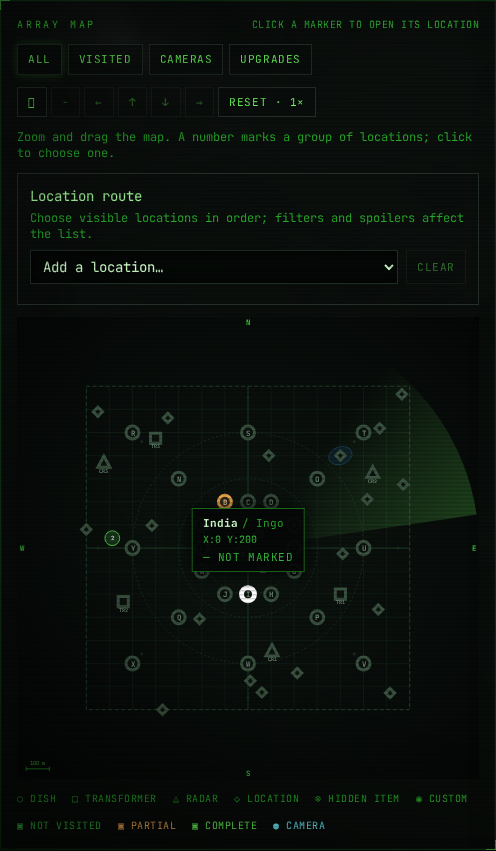
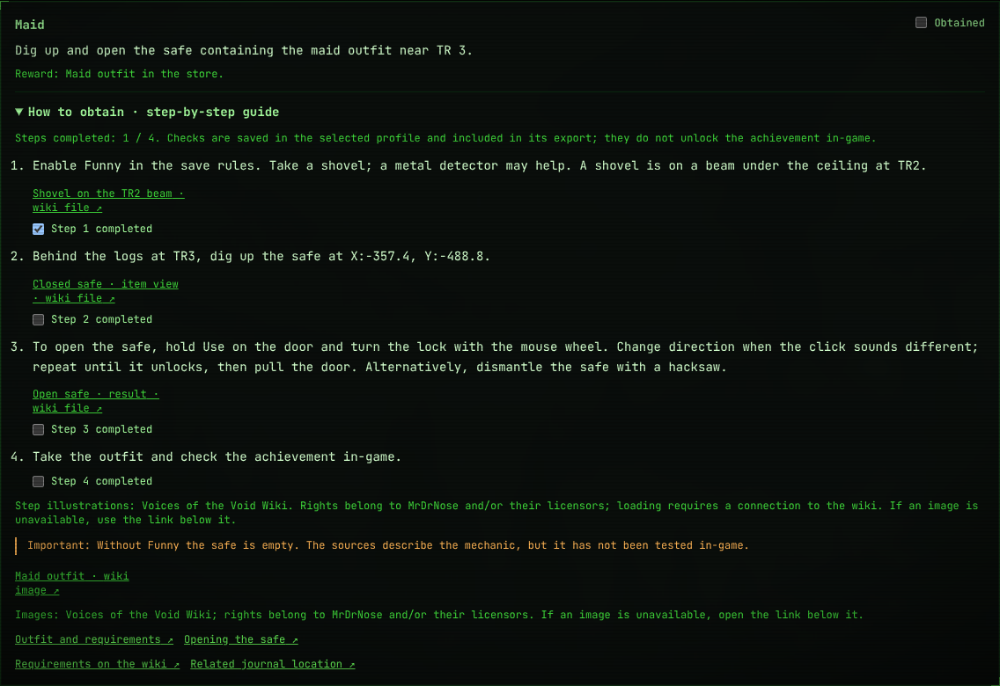
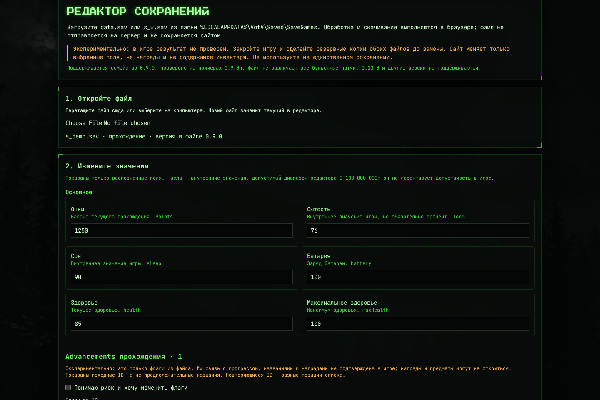

<div align="center">

# ◈ VotV Checklist

**Журнал обхода и справочник оператора для Voices of the Void**

Отмечайте посещённые места, следите за коллекциями и достижениями,\
а когда понадобится — ищите координаты и инструкции, не покидая сайт.

[Открыть сайт](https://efrem199.github.io/VotvChecklist/) · [Возможности](#features) · [Скриншоты](#screenshots) · [Запуск](#development) · [Источники](#sources)

</div>



> **Неофициальный проект.** Данные и гайды пересказаны по вики сообщества и могут быть неполными или отличаться от вашей версии игры. Отметки на сайте не синхронизируются с игрой автоматически.

<a id="features"></a>
## Возможности

### ◈ Журнал обхода

- **Интерактивная схема** с маркерами, масштабированием, группировкой близких точек и переходом к карточке.
- **Тарелки, трансформаторы, радары, точки интереса и тайники**: координаты, заметки, условия и ссылки на источники там, где они известны.
- **Маршрут** через выбранные точки и примерное расстояние по прямой, без учёта рельефа, с подсказками по подготовке.
- **Планировщик** Kerfur-Omega и удочки: компоненты, точки и отметки шагов для каждого профиля.
- **Свои точки и настраиваемые отметки** — для собственных маршрутов и задач.
- **Коллекции** с отдельным прогрессом: сэндвичи, Аргемии, черепа, плитки и инструменты. Есть фильтр ненайденных предметов.
- Поиск, фильтры и **скрытие спойлеров**, чтобы управлять тем, что показывается на карте и в списке.

### ★ Достижения и гайды

Отдельные списки общих достижений и advancements прохождения с ручными отметками, поиском и фильтрами. В карточках есть пошаговые гайды, предупреждения и источники; для ряда инструкций — изображения непосредственно у нужных шагов и мест.

Для сложных задач добавлены расширенные инструкции, например рецепт Kerfur-Omega, компоненты и места их поиска. Гайды основаны на вики и **не проверены в игре**; список достижений в источнике также помечен как незавершённый.

### ▣ Экспериментальный редактор сохранений

Редактор открывает файлы VotV **локально в браузере**, без отправки на сервер. Сейчас он рассчитан на семейство **0.9.0** и проверен на структуре примеров 0.9.0n; некоторые буквенные патчи не различаются по записанной в файле версии. **0.10.0 и другие версии не поддерживаются.** Заголовок GVAS можно посмотреть в диагностике даже для части неподдерживаемых файлов, но это не разрешает запись.

| Файл | Что можно изменить |
| --- | --- |
| `s_*.sav` | Очки, некоторые параметры персонажа, улучшения и правила; экспериментальные флаги advancements. |
| `data.sav` | Экспериментальные флаги общих достижений. |

> [!CAUTION]
> Перед редактированием **закройте игру и сделайте резервные копии обоих файлов**. Результат записи не проверен в игре. Флаги достижений показаны под внутренними ID: их связь с прогрессом и наградами не подтверждена, поэтому открытие предметов или наград не гарантируется. Инвентарь редактор не изменяет.

В редакторе выберите файл, измените доступные поля, просмотрите изменения и скачайте новую копию. Сайт **не перезаписывает** сохранение игры: заменить файл в папке игры нужно вручную. Неизменённые данные сохраняются побайтно.

### ✦ Команды и приколы

Справка по игровому терминалу, Funny rule, Sandbox и пасхалкам со ссылками на вики. Команды не проверены в игре; debug-команды и события могут изменить сохранение, поэтому сначала сделайте резервную копию.

<a id="screenshots"></a>
## Скриншоты

| Достижения и пошаговый гайд | Редактор сохранений |
| :---: | :---: |
| [](assets/readme/achievements.png) | [](assets/readme/save-editor.png) |
| Поиск, спойлеры и подробные инструкции | Пример с **искусственным** файлом и демонстрационными значениями |

Скриншоты сделаны в браузере с интерфейса проекта. Изображения в некоторых карточках загружаются с вики и требуют подключения к ней; при недоступности остаётся ссылка на страницу файла.

<a id="storage"></a>
## Прогресс и резервные копии

Данные журнала хранятся в `localStorage` браузера, а не в сохранении VotV. Разные браузеры, устройства и адреса сайта используют раздельное хранилище; очистка данных браузера может удалить отметки.

| Данные | Где хранятся | Входят в экспорт профиля? |
| --- | --- | --- |
| Точки, заметки, ритуалы, планировщик и настройки | В выбранном профиле браузера | Да |
| Advancements прохождения | В выбранном профиле браузера | Да |
| Общие достижения игры | Отдельно, общие для профилей | **Нет** |

Кнопки **«Экспорт»** и **«Импорт»** относятся только к выбранному профилю. Для резервной копии нескольких профилей экспортируйте каждый отдельно. Импорт заменяет данные выбранного профиля, включая advancements; старый экспорт без advancements очистит их отметки. Общие достижения в экспорт не входят и при очистке браузера могут быть потеряны. Сброс журнала также очищает шаги планировщика, но не сбрасывает отметки достижений.

Для файлов игры редактор предлагает скачать копию, но не хранит её в `localStorage`. Сохранения игры и JSON-экспорты журнала — **разные файлы**.

<a id="development"></a>
## Локальный запуск

Требуется **Node.js 20.19+ или 22.12+** и npm.

```bash
# Установить зависимости
npm ci

# Запустить локальный сервер разработки
npm run dev
```

Адрес сервера появится в терминале. Доступные команды:

```bash
npm test           # тесты
npm run typecheck  # проверка TypeScript
npm run build      # проверка типов и production-сборка
npm run preview    # просмотр собранной версии
```

### Сборка и GitHub Pages

`npm run build` создаёт автономный `dist/index.html`: стили, шрифты и фон встроены. Скриншоты из вики остаются внешними ссылками и могут быть недоступны без сети.

В репозитории хранится опубликованная сборка `docs/index.html`. После изменений сайта обновите её и включите в коммит:

```bash
npm run build
cp dist/index.html docs/index.html
cmp dist/index.html docs/index.html
```

CI запускает тесты и проверяет соответствие сборки файлу в `docs/`. Для GitHub Pages используйте сборку из `docs/`: при публикации корня репозитория корневой `index.html` перенаправляет на неё. Если публикуете из `main`, проверьте в настройках Pages, что выбран нужный источник и ветка.

### Структура проекта

```text
src/components/  страницы и компоненты интерфейса
src/data/        локации, коллекции, гайды и источники
src/lib/         состояние, маршруты и редактор сохранений
src/assets/      фон интерфейса
tests/           тесты данных, интерфейса и редактора
docs/index.html  готовая сборка для GitHub Pages
assets/readme/   скриншоты для этой страницы
```

<a id="sources"></a>
## Источники и благодарности

Проект использует информацию сообщества [Voices of the Void Wiki](https://voicesofthevoid.wiki.gg/), в том числе:

- [Руководство по достижениям](https://voicesofthevoid.wiki.gg/wiki/Guides/Achievements?oldid=25059)
- [Инструменты и скрытые предметы](https://voicesofthevoid.wiki.gg/wiki/Secrets/Hidden_Items/Tools)
- [Аргемии](https://voicesofthevoid.wiki.gg/wiki/Secrets/Hidden_Items/Argemia_Plushies)
- [Сэндвичи, черепа и плитки](https://voicesofthevoid.wiki.gg/wiki/Secrets/Hidden_Items/Miscellaneous_Collectibles)
- [Ритуалы](https://voicesofthevoid.wiki.gg/wiki/Secrets/Player-Activated/Rituals?oldid=25741)
- [Kerfur-Omega](https://voicesofthevoid.wiki.gg/wiki/Kerfur-Omega)

В карточках указаны источники и, где доступно, статус и дата сверки. Сверка с вики не означает проверку в игре. Координаты и условия могут измениться между версиями; если источники расходятся, в карточке может быть приведено несколько вариантов.

Voices of the Void и связанные с игрой изображения принадлежат их правообладателям. Проект не является официальным сайтом игры. Изображения вики загружаются с сайта вики и не копируются в репозиторий.
