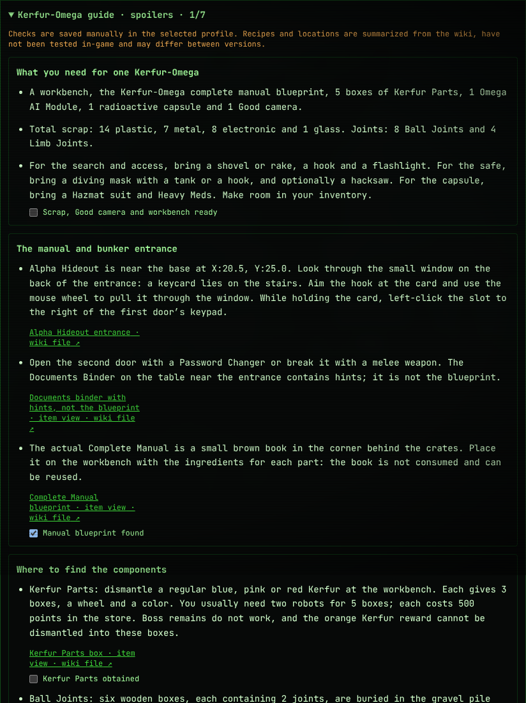

<div align="center">

# ◈ VotV Checklist

**An operator's field journal and reference for Voices of the Void**

Track visited locations, collections and achievements,\
and find coordinates and instructions without leaving the site.

[Open the site](https://efrem199.github.io/VotvChecklist/) · [Features](#features) · [Screenshots](#screenshots) · [Development](#development) · [Sources](#sources)

</div>

<p align="center"></p>

> **Unofficial project.** Data and guides are summarized from the community wiki and may be incomplete or differ from your game version. Checkmarks on this site do not automatically synchronize with the game.
>
> **Languages:** English is the default, and the language selector also offers Russian. Built-in locations, rituals and all 91 available achievement guides (including detail sections and image captions) have English translations. The original profile is named `Default`; its previous built-in names are migrated automatically. Other profile names, notes, edited columns and existing event history remain as entered. Some wiki links do not have a verified Russian counterpart; original sources are retained and labeled, and Russian counterparts may describe different versions.

<a id="features"></a>
## Features

### ◈ Field journal

- **Interactive map** with markers, zoom, clustering of nearby locations and links to location cards.
- **Dishes, transformers, radars, points of interest and caches**: coordinates, notes, requirements and source links where known.
- **Route planning** through selected locations, with approximate straight-line distance (terrain is not considered) and preparation tips.
- **Guides and step checklists inside location cards**: Kerfur-Omega at Alpha Hideout and the fishing rod at the fisherman's equipment. Related locations share the same task checkmarks as the guide. There is no separate planner; the Upgrade achievement links to the Kerfur-Omega guide.
- **Custom locations and configurable checkmarks** for your own routes and tasks.
- **Collections** with separate progress for sandwiches, Argemias, skulls, tiles and tools, plus a filter for items not yet found.
- Search, filters and **spoiler controls** for the map and list.

### ★ Achievements and guides

Separate lists of global achievements and per-save advancements offer manual checkmarks, search and filters. Cards include step-by-step guides with manual checklists, warnings and sources; some instructions have images next to the relevant steps and locations. Guide steps belong to the selected profile and do not unlock achievements in the game.

More detailed instructions are available for complex tasks. The full Kerfur-Omega guide is in the Alpha Hideout card in the journal and is linked from the Upgrade achievement. Guides are based on the wiki and **have not been verified in-game**; the source's achievement list is also marked incomplete.

### ▣ Experimental save editor

The editor opens VotV files **locally in your browser**, without uploading them to a server. It currently targets the **0.9.0** family and has been checked against example 0.9.0n file structures; the version recorded in the file does not distinguish every lettered patch. **0.10.0 and other versions are not supported.** The GVAS header can be inspected for some unsupported files, but that does not enable editing them.

| File | What can be edited |
| --- | --- |
| `s_*.sav` | Points, some character values, upgrades and rules; experimental advancement flags. |
| `data.sav` | Experimental global achievement flags. |

> [!CAUTION]
> **Close the game and back up both files** before editing. Edited files have not been tested in-game. Achievement flags are shown by internal ID: their relationship to progress and rewards is unconfirmed, so unlocking items or rewards is not guaranteed. The editor does not change inventory contents.

Choose a file, edit available fields, review your changes and download a new copy. The site **does not overwrite** your game save: replace the file in the game folder manually. Unchanged data is preserved byte for byte.

### ✦ Commands and fun

A reference for the in-game terminal, Funny rule, Sandbox and Easter eggs, with wiki links. Commands have not been tested in-game; debug commands and events can alter your save, so make a backup first.

<a id="screenshots"></a>
## Screenshots

<table align="center">
  <tr><th>Kerfur-Omega guide in a location card</th><th>Achievement and step checkmarks</th></tr>
  <tr>
    <td align="center"><a href="assets/readme/kerfur-guide.png"></a></td>
    <td align="center"><a href="assets/readme/achievements.png"></a></td>
  </tr>
  <tr><td align="center">Guide excerpt with manual checkmarks</td><td align="center">Steps, warnings and links to illustrations</td></tr>
</table>

<p align="center"><a href="assets/readme/save-editor.png">Save editor screenshot</a></p>

Screenshots were taken in a browser using a demonstration profile; the save editor screenshot uses a synthetic example file, not a real save. The Kerfur-Omega image is an excerpt of the guide. Screenshots of guides show the fallback when wiki images are unavailable: links to the file pages remain visible. Loading the images themselves requires a connection to the wiki.

<a id="storage"></a>
## Progress and backups

Journal data is stored in your browser's `localStorage`, not in a VotV save. Different browsers, devices and site addresses use separate storage; clearing browser data can delete your checkmarks.

| Data | Storage | Included in profile export? |
| --- | --- | --- |
| Locations, notes, rituals, guide steps and settings | Selected browser profile | Yes |
| Per-save advancements | Selected browser profile | Yes |
| Global game achievements | Separate, shared across profiles | **No** |

**Export** and **Import** apply only to the selected profile. To back up multiple profiles, export each one separately. Import replaces the selected profile's data, including advancements; importing an older export without advancements clears those checkmarks. Global achievements are not included in the export and may be lost when browser data is cleared. Resetting the journal also clears guide steps but does not reset achievement checkmarks.

The save editor downloads a copy of the game file but does not store it in `localStorage`. Game saves and JSON journal exports are **different files**.

<a id="development"></a>
## Local development

Requires **Node.js 20.19+ or 22.12+** and npm.

```bash
# Install dependencies
npm ci

# Start the local development server
npm run dev
```

The server address appears in the terminal. Available commands:

```bash
npm test           # tests
npm run typecheck  # TypeScript checks
npm run build      # type checks and production build
npm run preview    # preview the production build
```

Mobile layout checks run in a real Chrome/Chromium browser at several viewport widths in both languages. Install Chrome or Chromium locally and run `npm run test:mobile`; if it is not in a standard Linux location, set `CHROMIUM_PATH` to its executable.

### Build and GitHub Pages

`npm run build` creates a standalone `dist/index.html`, with styles, fonts and background embedded. Wiki screenshots remain external and may be unavailable without a network connection.

The published build is kept in `docs/index.html`. After changing the site, update it and include it in the commit:

```bash
npm run build
cp dist/index.html docs/index.html
cmp dist/index.html docs/index.html
```

CI runs tests and checks that the build matches the file in `docs/`. For GitHub Pages, publish the build from `docs/`: if the repository root is published, the root `index.html` redirects to it. If publishing from `main`, verify the source and branch in the Pages settings.

### Project structure

```text
src/components/  pages and interface components
src/data/        locations, collections, guides and sources
src/lib/         state, routes and save editor
src/assets/      interface background
tests/           data, UI and save editor tests
docs/index.html  built page for GitHub Pages
assets/readme/   screenshots used in this README
```

<a id="sources"></a>
## Sources and acknowledgements

This project uses community information from the [Voices of the Void Wiki](https://voicesofthevoid.wiki.gg/), including:

- [Achievement guide](https://voicesofthevoid.wiki.gg/wiki/Guides/Achievements?oldid=25059)
- [Tools and hidden items](https://voicesofthevoid.wiki.gg/wiki/Secrets/Hidden_Items/Tools)
- [Argemias](https://voicesofthevoid.wiki.gg/wiki/Secrets/Hidden_Items/Argemia_Plushies)
- [Sandwiches, skulls and tiles](https://voicesofthevoid.wiki.gg/wiki/Secrets/Hidden_Items/Miscellaneous_Collectibles)
- [Rituals](https://voicesofthevoid.wiki.gg/wiki/Secrets/Player-Activated/Rituals?oldid=25741)
- [Kerfur-Omega](https://voicesofthevoid.wiki.gg/wiki/Kerfur-Omega)

Location cards list sources and, where available, review status and date. Checking against the wiki does not mean in-game verification. Coordinates and requirements may change between versions; where sources disagree, a card may list multiple possibilities.

Voices of the Void and related game images belong to their respective owners. This is not an official game website. Wiki images are loaded from the wiki and are not copied into this repository.
